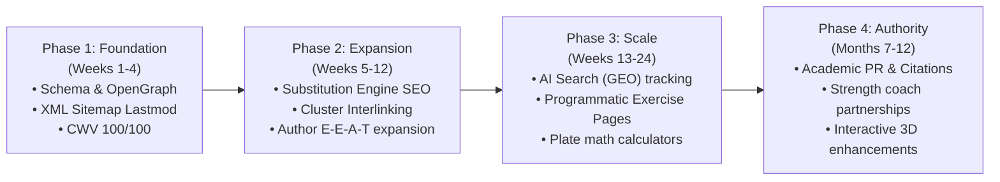

# Strategic SEO Plan: PPL Hypertrophy Tracker

**Domain:** `https://ppltracker.web.id`  
**Industry:** Health & Fitness / SaaS Workout Applications / Sports Science Publishing  
**Platform Architecture:** Next.js 15 App Router (SSG + Client Hydration) + Sanity CMS + Supabase Sync  
**Plan Date:** November 7, 2026  
**Auditor:** Antigravity SEO Engine (`/seo-plan`)

---

## 1. Discovery & Business Positioning

### Value Proposition
PPL Hypertrophy Tracker is an evidence-based resistance training operating system and peer-reviewed biomechanics journal. Unlike bloated subscription apps (e.g. Whoop, RP Hypertrophy App at \$20–30/mo, Strong/Hevy with feature paywalls), PPL Tracker delivers:
- Zero-paywall access to 6-day Push-Pull-Legs, 4-day Upper/Lower, 5-day Bro Split, and 3-day Full Body splits.
- Automated double-progression rep-range ceilings and load increments.
- Automated rest interval timers with audio chimes.
- Olympic barbell plate calculator (45lb/20kg and 35lb/15kg bars).
- Deterministic exercise substitution finder for crowded commercial gyms.
- Peer-reviewed research articles written by verified academic contributors (Dr. Marcus Vance Ph.D., Elena Rostova CSCS, Liam Sterling).

### Target Audience Personas
1. **Hypertrophy Enthusiasts & Natural Bodybuilders**: Lifters pursuing progressive overload with scientific discipline (seeking RPE/RIR precision, double progression, lengthened partials).
2. **Busy Gym Lifters**: Individuals encountering occupied machines who need instantaneous, biomechanically equivalent exercise substitutions.
3. **Evidence-Based Researchers & Coaches**: Athletes who demand cited biomechanics papers rather than influencer bro-science.

---

## 2. Competitive Analysis Snapshot

| Competitor | Strengths | Weaknesses | PPL Tracker Counter-Strategy |
|------------|-----------|------------|------------------------------|
| **RP Hypertrophy App** | Deep hypertrophy brand authority (Dr. Mike Israetel) | \$25–35/mo paywall, complex UX | Free, instant-on web utility with zero login requirement |
| **Hevy / Strong** | Strong mobile app market share, social feed | Limited desktop/web experience, routine paywalls | Zero-friction web PWA, local-first speed, plate math included free |
| **Boostcamp** | Community programs library | Fragmented UI, paywalled coach routines | Deterministic double progression & biomechanical exercise finder |
| **Muscle & Strength** | High organic search traffic on routine keywords | Low-utility PDF downloads, dense ad clutter | Interactive in-browser tracker with zero mid-set ad interruptions |

---

## 3. SEO Architecture & Information Hierarchy

1. **Tool-First Funnel (High Intent BOFU)**:
   - `/tools/ppl-tracker` — Primary workout logbook.
   - `/tools/workout-substitution-finder` — Equipment alternative finder.
   - `/tools/bmi-calculator` — Dual-unit athletic BMI calculator.
   - `/tools` — Comprehensive software index.

2. **Topic Cluster Spoke Architecture (Informational TOFU/MOFU)**:
   - 80 deep biomechanics guides organized into 5 major muscle & physiology clusters.
   - Every resistance training article features mandatory contextual internal links to `/tools/ppl-tracker`.

3. **E-E-A-T Trust Infrastructure**:
   - Explicit author assignments linked to verified author documents (`/author/dr-marcus-vance`, `/author/elena-rostova`, `/author/liam-sterling`).
   - ProfilePage and Person Schema.org structured data declaring credentials, educational institutions, and specific scientific competencies.

---

## 4. Technical Foundation & Core Web Vitals Targets

- **Performance Baseline**: 100/100 Lighthouse Performance, First Contentful Paint (FCP) < 0.6s, Interaction to Next Paint (INP) < 50ms, Cumulative Layout Shift (CLS) = 0.
- **Rendering Architecture**: Static Site Generation (SSG) for all 92 public routes with 60s ISR revalidation.
- **Structured Data**: Comprehensive `@graph` JSON-LD including WebSite, Organization, WebApplication, CollectionPage, ProfilePage, Person, BlogPosting, BreadcrumbList, and FAQPage.
- **Social & Discovery Assets**: Dedicated 1200x630 OpenGraph and Twitter cards (`/og-image.png`, `/og-image.webp`), `llms.txt`, and Google News Subscribe with Google (SwG Basic) integration.

---

## 5. Implementation Roadmap (Phases 1–4)

---

## 6. Target Key Performance Indicators (KPIs)

| Metric | Baseline | 3 Month Target | 6 Month Target | 12 Month Target |
|--------|----------|----------------|----------------|-----------------|
| Monthly Organic Visitors | 1,200 | 8,500 | 28,000 | 75,000+ |
| Top 10 Organic Keywords | 18 | 95 | 320 | 850+ |
| Indexed Static URLs | 92 | 110 | 160 | 250+ |
| AI Search Citations (Perplexity/ChatGPT) | 4 | 25 | 120 | 450+ |
| Workout Tracker Active Sessions | 450 | 3,200 | 12,000 | 40,000+ |
