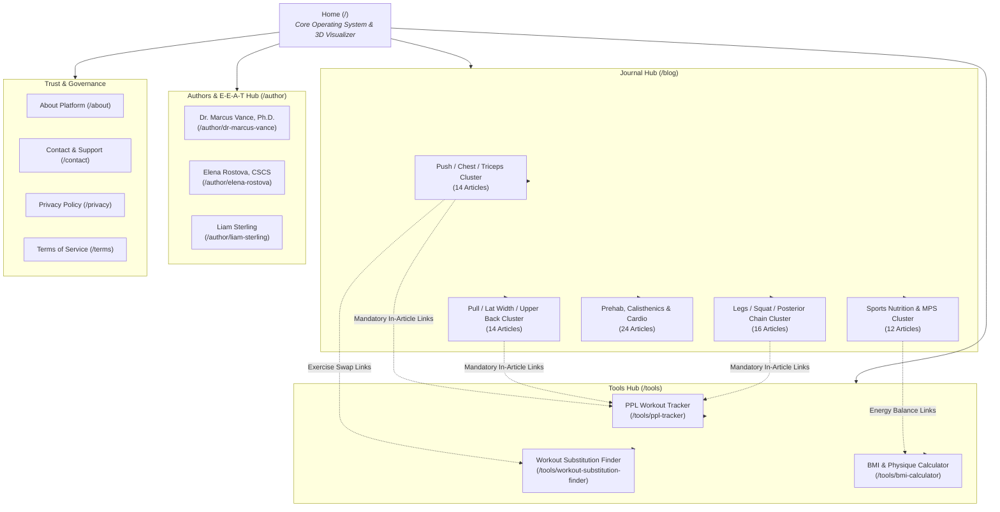

# PPL Tracker — Information Architecture & Site Structure

**Canonical Origin:** `https://ppltracker.web.id`  
**Architecture Pattern:** Hub-and-Spoke with High-Utility SaaS Applications & Scientific Pillar Clusters

---

## 1. Global Hierarchy Diagram

---

## 2. URL Directory Directory Map

### A. Root & Web Applications (High-Intent Conversion Pillar)
- `https://ppltracker.web.id/` — Flagship interactive application, demo visualizer, and feature breakdown.
- `https://ppltracker.web.id/tools` — Complete software directory indexing all utilities.
- `https://ppltracker.web.id/tools/ppl-tracker` — Focused 6-day workout logbook, rest timer engine, and Olympic barbell plate math.
- `https://ppltracker.web.id/tools/workout-substitution-finder` — Biomechanical alternative calculator for crowded gyms and home workouts.
- `https://ppltracker.web.id/tools/bmi-calculator` — Dual-unit BMI calculator tailored with muscle-mass contextual guidance for lifters.

### B. Scientific Editorial & Peer Review
- `https://ppltracker.web.id/blog` — Primary publication collection page with split category filters and reading time badges.
- `https://ppltracker.web.id/blog/{slug}` — 80 deep biomechanical research articles with table of contents, accessible accordions, and Google SwG integration.

### C. Verified Author Profiles (Google E-E-A-T Foundation)
- `https://ppltracker.web.id/author` — Editorial board overview and peer-review process documentation.
- `https://ppltracker.web.id/author/dr-marcus-vance` — Lead Biomechanics Researcher (Stanford Ph.D., CSCS).
- `https://ppltracker.web.id/author/elena-rostova` — Head of High-Performance S&C (Ohio State B.S., CSCS, USAW L2).
- `https://ppltracker.web.id/author/liam-sterling` — Natural Bodybuilding Coach (WNBF Pro, NASM CPT).

### D. Governance & Trust Pages
- `https://ppltracker.web.id/about` — Research methodology, software engineering principles, and core values.
- `https://ppltracker.web.id/contact` — Technical support and scientific editorial contact.
- `https://ppltracker.web.id/privacy` — Transparent data handling, local-first storage, and cookie consent disclosures.
- `https://ppltracker.web.id/terms` — Terms of use, exercise safety disclaimer, and limitation of liability.

---

## 3. Crawl Equity & Index Budget Safeguards

1. **Restricted Paths**:
   - `/studio/*` (Sanity CMS management interface) — strictly `Disallow: /studio/` in `robots.ts` and `noindex`.
   - `/api/*` (Backend route handlers) — `Disallow: /api/`.
   - `/auth/callback` (OAuth callback loop) — `Disallow: /auth/callback`.

2. **Crawl Efficiency**:
   - Total indexable HTML footprint is 92 pristine, statically pre-rendered (SSG) URLs.
   - Initial page loads hydrate in < 200 ms with zero client-side redirection chains.
